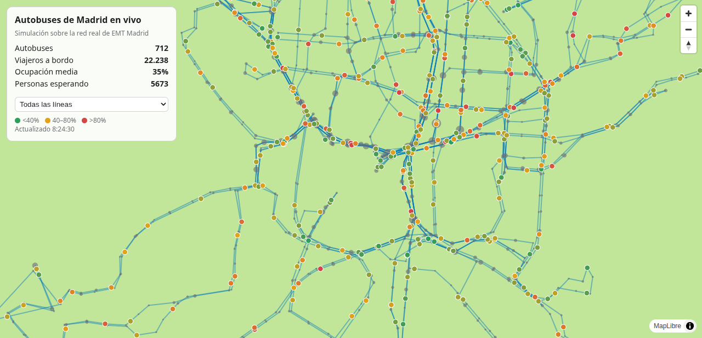
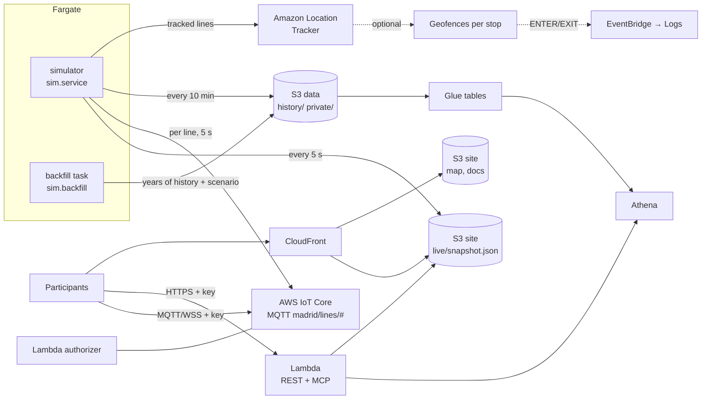

# Madrid Bus Real-Time Simulator

> ⚠️ **Learning material, not production software.**

A live simulation of 40 real EMT Madrid bus lines with years of synthetic history behind it,
built for data hackathons. Buses run their real routes, people arrive at the real stops, board,
ride and get off; Madrid's calendar and its events shape the demand. Participants consume it in
real time (MQTT, web map) and as history (HTTP API, SQL, Parquet, MCP for AI agents).



- **Real network**: 40 lines, 1,723 stops and 712 buses from the official EMT Madrid GTFS feed.
- **One consistent world**: a single process owns every bus and every stop queue, so the person
  who arrives at a stop is the person a bus later picks up. Passenger totals always balance.
- **A hidden story**: each history generation draws a secret scenario — line loads (central lines
  busier), one overloaded peripheral line, a snowstorm, football, concerts, a festival, Pride,
  bullfights, holidays, school traffic, summer… Dates and places are random, so the story can
  only be found in the data.
- **AWS**: Fargate, IoT Core (MQTT), S3 + Athena, Lambda (API + MCP), CloudFront, Amazon Location
  (routes, maps, tracker, geofences), Budgets.
- **Runs locally without AWS**: `make run`, `make preview`, `make backfill-local`.

## Surfaces and their contracts

| Surface | For | Contract |
|---|---|---|
| Web map | everyone | `https://<site>/` |
| API docs | participants | `https://<site>/docs.html` (Swagger UI + AsyncAPI) |
| HTTP API (live, history, SQL, Parquet downloads) | participants | [docs/api/openapi.yaml](docs/api/openapi.yaml) |
| MQTT on AWS IoT Core (real time) | participants | [docs/api/asyncapi.yaml](docs/api/asyncapi.yaml) |
| MCP server (AI agents) | participants | [docs/api/mcp.md](docs/api/mcp.md) |
| Historical tables | participants | [docs/api/datasets.md](docs/api/datasets.md) |
| Live snapshot `live/snapshot.json` | map, quick scripts | [docs/api/openapi.yaml](docs/api/openapi.yaml) (public server) |

Participants need only their group key (`make keys`). Their guide, in Spanish, is
[docs/guides/participantes.md](docs/guides/participantes.md); examples are in [examples/](examples/).

## Quick start (local, no AWS)

```bash
make venv              # Python 3.12 virtualenv with dev dependencies
make test              # lint + tests
make run               # simulate 2 h from 07:30 and print a health summary
make preview           # map at http://localhost:8000 (SPEEDUP=60 to fast-forward)
make backfill-local YEARS=1   # history into .cache/history (Parquet)
```

## How it works



### The simulator (`src/container/sim/`)

| Module | Responsibility |
|---|---|
| `network.py` | Each line is a **closed circuit** (outbound + inbound legs) measured in metres; stops are visits at fixed offsets. |
| `engine.py` | `World.step(dt)`: Poisson arrivals per (stop, line, direction) queue, buses drive/dwell/lay over, riders alight then board up to capacity (up to 120 % on an overloaded line). |
| `scenario.py` | The hidden story: per-line load targets by distance to the centre, one overloaded peripheral line, Madrid's calendar (holidays, school terms, summer, Holy Week) and random events. Yields demand/speed factors at any instant. |
| `history.py` | Table schemas (single source of truth), Parquet writer, hourly aggregation of simulated ticks. |
| `backfill.py` | Generates 1-3 years of history: calibration on the real network, an hourly model for the years, full microsimulation for the last days. |
| `service.py` | The live Fargate service: real-time loop, S3 snapshot, MQTT, tracker, history recording. |
| `mqtt.py`, `aws.py` | AWS adapters. `preview.py`: local web server. |

### History

`make backfill YEARS=3` runs a one-off Fargate task (4 vCPU, about 15 minutes):

1. Draws a scenario from a fresh secret seed. It is stored only in `private/scenario.json` in the
   data bucket — the organisers' answer key; participants cannot reach it.
2. Calibrates one demand factor per line with the microsimulation so each line hits its target
   rush-hour load (central lines ~45-60 %, peripheral ~30-40 %, the overloaded line 90-100 % with
   peaks of 120 %).
3. Writes `line_hourly` and `stop_hourly` for the years with an hourly model scaled from that
   calibration, and fully simulates the last 7 days, which also yields `stop_calls` and
   `bus_positions`.
4. The live service then continues the same tables and the same scenario from where the history
   ends.

Events the scenario can contain (dates, venues and intensities are random each time): a
three-day snowstorm once a year, national day parade, bullfighting Sundays and a spring fair,
Pride week and parade, carnival, Halloween, Holy Week processions, Sunday football at the three
stadiums, three Friday-Sunday concert runs per quarter, a four-day summer festival
(Wednesday-Saturday), heat waves, rain days, accidents, breakdowns, roadworks and protests.

### Data

`data/lines.yaml` is generated from the [EMT Madrid GTFS](https://servicios.emtmadrid.es:8443/gtfs/transitemt.zip)
by `bin/import_gtfs.py` (`make import-gtfs`); `make network` snaps the lines to streets with
Amazon Location Routes. EMT Madrid open data, reused under its
[terms of use](https://mobilitylabs.emtmadrid.es/sip/terms-of-use).

## Deploy and run the event

See **[docs/ops/deploy.md](docs/ops/deploy.md)**: one-time bootstrap (Terraform state + GitHub OIDC
roles), GitHub workflows (`deploy-app` for the image, `deploy-web` for the site, `infra` for
Terraform plan/apply), and the event-day runbook:

```bash
make deploy                 # day before: infrastructure + image
make backfill YEARS=3       # generate the history (~15 min)
make keys                   # one key per group, for MQTT, API and MCP
make smoke                  # live snapshot has moving, loaded buses
make stop                   # after the event (or make destroy)
```

Requirements: Terraform ≥ 1.10, Docker with buildx, AWS credentials.

### Cost

AWS Budgets alerts by email on a daily ($25) and a monthly ($60) budget, on actual and
forecasted spend (`budget_alert_emails`, `daily_budget_limit`, `monthly_budget_limit`). Expected
cost for a one-day event, eu-west-1 list prices:

| Item | Per day |
|---|---|
| Fargate simulator (0.5 vCPU / 1 GB ARM) + backfill task | ≈ $0.6 |
| IoT Core: ~1.1 M publishes/day + deliveries ($1 per million) | ≈ $1-5 |
| S3 snapshot every 5 s, history writes, Athena ($5/TB scanned) | ≈ $0.5 |
| Amazon Location tracker, line 27 only (heartbeat 120 s) | ≈ $0.9 |
| Lambda, CloudFront, map tiles | < $1 |

Writing every bus to the tracker (`tracked_lines = "all"`) or enabling stop geofences multiplies
the Location cost (≈ $15/day and ≈ $100/day respectively).

## Development

```
iac/                Terraform: stack/ (the platform), bootstrap/ (state + CI roles), modules/
src/
  container/        Fargate image: Dockerfile + sim package (engine, scenario, backfill, service)
  lambda/           api/ (REST + MCP), iot-authorizer/ (MQTT group keys)
bin/                operator and data scripts: import_gtfs, build_network, export_*, smoke
web/                map and API docs pages (published to S3/CloudFront)
data/               lines.yaml (from GTFS), network.json (from Amazon Location Routes)
docs/               api/ (contracts), ops/ (deploy runbook), guides/ (participants), img/
tests/              sim/, lambdas/, bin/, contracts/ (docs vs code)
examples/           participant examples (MQTT, API, MCP)
memory-bank/        project knowledge for maintainers and agents
```

Tests guard the simulation (whole-network invariants: conservation, capacity, every stop served),
the scenario rules (one snowstorm a year, concerts Friday-Sunday, football only on Sundays…), the
history (schemas, no gaps between the hourly model and the microsimulation), the AWS adapters
(botocore stubs) and the docs (every route, topic and tool is documented). CI runs lint, tests and
`terraform validate`.

## License

MIT, see [LICENSE](LICENSE). Bus network data © EMT Madrid.
