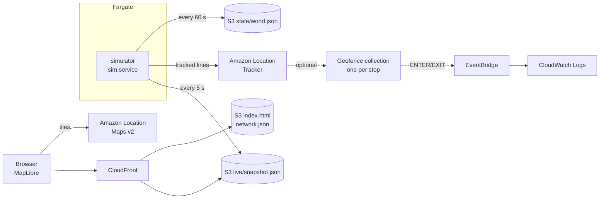

# Madrid Bus Real-Time Simulator

> ⚠️ **Learning material, not production software.**

A live simulation of 40 real EMT Madrid bus lines: buses run their real routes, people arrive at
the real stops following the daily demand profile, board, ride and get off. It runs on AWS
(Fargate + Amazon Location + S3/CloudFront) and is shown on a web map.


- **Real network**: 40 lines, 1,723 stops and 712 buses taken from the official EMT Madrid GTFS
  feed (fleet size from peak headways, cruising speed from timetabled run times).
- **One consistent world**: a single process owns every bus and every stop queue, so the person
  who arrives at a stop is the person a bus later picks up. Passenger totals always balance.
- **Amazon Location Service**: street geometry from the Routes API, base map from the Maps API,
  bus positions and 30-day history in a Tracker, optional per-stop Geofences.
- **Runs locally without AWS**: `make run` and `make preview`.

## Quick start (local, no AWS)

```bash
make venv          # Python 3.12 virtualenv with dev dependencies
make test          # lint + 54 tests (~15 s)
make run           # simulate 2 h from 07:30 and print a health summary
make preview       # map at http://localhost:8000 (SPEEDUP=60 to fast-forward)
```

`make run` prints something like:

```
simulated ticks     : 1440 (until 09:30)
mean occupancy      : 28%
arrived / boarded   : 166618 / 163494
alighted / on board : 153756 / 9738
waiting now / max   : 3124 / 7191
unvisited stops     : none
status              : OK
```

Without an Amazon Location key the preview uses MapLibre's demo tiles.

## How the simulation works

`sim/` is a small discrete-time traffic simulator, in the spirit of SUMO but limited to buses
and passengers. It has no AWS dependencies.

| Module | Responsibility |
|---|---|
| `network.py` | Each line is a **closed circuit** (outbound leg + inbound leg) measured in metres. Stops are *visits* at fixed offsets; a terminal visit ends one leg and starts the next. Circular lines have a single leg. |
| `engine.py` | `World.step(dt)`: Poisson arrivals into one queue per (stop, line, direction), then every bus spends `dt` driving, dwelling or laying over, calling at as many stops as it reaches. At a stop, riders alight (probability 1 / stops left in the leg; everyone at a terminal), then board up to capacity. Dwell time grows with boardings and alightings; terminals have a 2 min layover. |
| `demand.py` | Time-of-day multipliers (rush hours 06–09 and 18–21) and Poisson sampling. |
| `config.py` | Loads `data/lines.yaml` and, when present, `data/network.json` street geometry. |
| `aws.py` / `service.py` | The Fargate service: real-time loop, S3 snapshot, Amazon Location tracker, stop geofences, state for restarts. |
| `preview.py` | Local web server with an in-process simulation. |

Arrival detection compares visit indices, never floating-point positions, and the time budget
of a tick is carried across stops, so a bus never skips a stop or stalls at a terminal.

### Data

`data/lines.yaml` is generated from the EMT Madrid GTFS feed by `tools/import_gtfs.py`
(see its docstring for the formulas). Shared stops are shared between lines; a stop's arrival
rate is split between the line/direction queues that serve it. `demand_scale` is calibrated so
that the rush-hour mean occupancy is about 30 %.

```bash
make import-gtfs                 # download the feed and rebuild data/lines.yaml
make import-gtfs LINES=27,C1,5   # pick other lines
make network                     # snap every line to streets (Amazon Location Routes)
```

`make network` calls `geo-routes:CalculateRoutes` once per 24 stops of each direction (about
140 requests, Core pricing) and writes `data/network.json`. Without that file buses run
straight from stop to stop.

Source data: [EMT Madrid GTFS](https://servicios.emtmadrid.es:8443/gtfs/transitemt.zip),
open data from EMT Madrid (Empresa Municipal de Transportes de Madrid), reused under its
[terms of use](https://mobilitylabs.emtmadrid.es/sip/terms-of-use).

## Architecture on AWS



- **Simulator** (`terraform/simulator.tf`): one Fargate task (ARM64, 0.5 vCPU). It resumes from
  `state/world.json` after a restart if the state is less than 15 minutes old.
- **Map** (`terraform/site.tf`, `web/index.html`): a static page polling
  `live/snapshot.json` every 5 s through CloudFront and animating the buses between polls.
  The bucket is private; CloudFront reads only `index.html`, `network.json` and `live/*`.
- **Amazon Location** (`terraform/location.tf`): an API key restricted to map tiles and to the
  CloudFront domain, a tracker for the buses of `tracked_lines`, and optional stop geofences.

### Deploy

Requirements: Terraform ≥ 1.5, Docker with buildx, AWS credentials.

```bash
make plan                        # review
make deploy                      # create ECR, build and push the image, apply, print the map URL
make smoke                       # check the live snapshot has moving, loaded buses
make logs                        # simulator logs
make destroy
```

Terraform variables (`terraform/variables.tf`):

| Variable | Default | Meaning |
|---|---|---|
| `aws_region` | `eu-west-1` | Must offer Amazon Location Maps/Routes v2 |
| `lines` | `""` | Subset of lines to simulate (empty = all 40) |
| `tracked_lines` | `"27"` | Lines written to the Amazon Location tracker: ids, `all` or `""` |
| `heartbeat_seconds` | `120` | Seconds between two tracker writes of a bus |
| `stop_geofences` | `false` | Per-stop geofences + stop-call writes, ENTER/EXIT events in CloudWatch Logs |
| `monthly_budget_limit` / `budget_alert_emails` | `100` / `[]` | AWS Budgets alert |

The simulator itself reads its settings from environment variables, documented at the top of
`sim/service.py`.

### Cost

Amazon Location bills every tracker write and every geofence evaluation, so the full fleet is
**not** sent to the tracker by default. The map gets every bus from the S3 snapshot instead.
Estimates use eu-west-1 list prices after the free tier:

| Item | Monthly |
|---|---|
| Fargate, 0.5 vCPU / 1 GB ARM, always on | ≈ $14 |
| S3 snapshot (every 5 s) + state | ≈ $3 |
| Tracker, line 27 (25 buses, heartbeat 120 s, ≈ 0.54 M writes) | ≈ $26 |
| Map tiles | $0.04 per 1,000 tiles |
| **Default total** | **≈ $45 + viewers** |
| Tracker for all 712 buses (heartbeat 120 s, ≈ 15 M writes) | ≈ $440 |
| All 712 buses with stop geofences (≈ 33 M writes + evaluations) | ≈ $3,200 |

## Development

```
sim/            simulator package (engine, network, demand, AWS adapters, service, preview)
tools/          import_gtfs.py, build_network.py, export_web.py, smoke.py
data/           lines.yaml (from GTFS), network.json (from Amazon Location Routes)
web/            the map (single HTML file)
terraform/      infrastructure
tests/          pytest suite
```

Tests are grouped by what they protect:

- `test_invariants.py`: whole-network runs (real Madrid network and random networks via
  Hypothesis) checking that people are never created or lost, capacity holds, terminals empty
  the bus, every bus moves and every stop is served, and rush-hour buses carry people.
- `test_network.py`, `test_engine.py`, `test_config.py`: edge cases such as several stops in one
  tick, terminals at the end of the circuit, shared stops, circular lines and state round trips.
- `test_aws.py`, `test_build_network.py`: AWS request shapes against botocore stubs.

CI (`.github/workflows/test.yml`) runs lint, tests and `terraform validate`.

## License

MIT, see [LICENSE](LICENSE). Bus network data © EMT Madrid.
